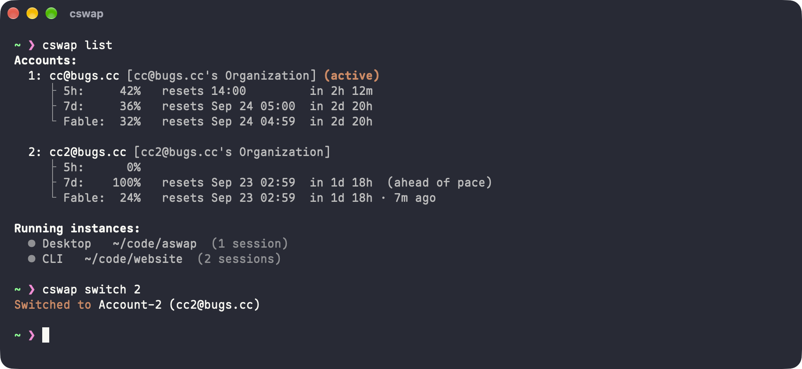
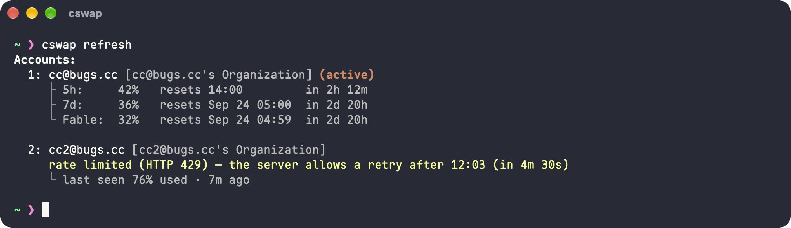
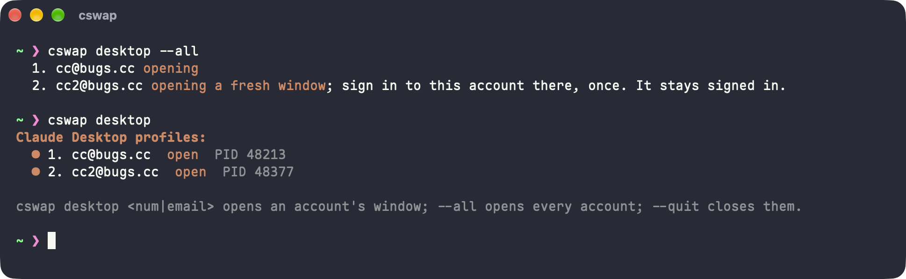
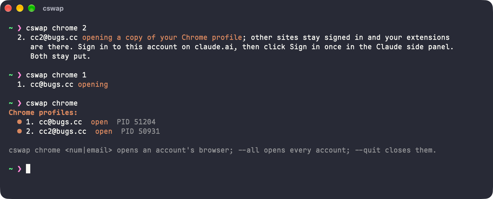

<div align="center">

# aswap

[English](../../README.md) | [简体中文](README.zh-CN.md) | [繁體中文](README.zh-TW.md) | [日本語](README.ja.md) | [한국어](README.ko.md) | Русский | [Français](README.fr.md) | [Español](README.es.md)



Переключение между аккаунтами Claude Code через [claude-swap](https://github.com/realiti4/claude-swap) с поддерживаемым набором исправлений и новых возможностей.

</div>

`cswap` управляет несколькими аккаунтами Claude. Он отслеживает расход лимитов каждого аккаунта и умеет переключаться на аккаунт с наибольшим остатком квоты. aswap собирает `cswap` из неизменённого исходного кода upstream и применяет поверх него небольшой набор патчей. Все команды `cswap` работают как прежде.

Название расшифровывается как **account swap**.

## Установка

```bash
uv tool install aswap  # или: pipx install aswap
aswap --version
```

`aswap` принимает все команды `cswap`. Он устанавливается рядом с upstream-версией `cswap` и не затрагивает её.

Чтобы aswap запускался и под именем `cswap`:

```bash
aswap link    # добавить лаунчер cswap рядом с aswap
aswap unlink  # удалить его
```

`aswap link` заменяет только тот лаунчер `cswap`, который создан при установке aswap. Чтобы заменить upstream `cswap`, сначала удалите его (`uv tool uninstall claude-swap`) или передайте `--force`.

Для обновления выполните `aswap upgrade`. Команда вызывает `uv tool upgrade` или `pipx upgrade` в зависимости от того, как был установлен aswap.

## Что добавляет aswap

### Обновление расхода по запросу

`cswap refresh [account ...]` сразу запрашивает данные о расходе, по одному аккаунту за раз. Если для аккаунта сработало ограничение частоты запросов, команда показывает, когда сервер разрешит следующую попытку.



### Отдельное окно Claude Desktop для каждого аккаунта

Claude Desktop поддерживает только один вход в аккаунт одновременно. `cswap desktop 2` открывает аккаунт 2 в отдельном окне с собственным входом, а `cswap desktop --all` открывает все аккаунты. Вкладка Code в каждом окне показывает одни и те же локальные сессии (кроме Windows). Подход заимствован у [guise](https://github.com/siddhjagani/guise).



### Отдельный профиль Chrome для каждого аккаунта

Claude in Chrome использует вход в claude.ai из браузера, а не аккаунт, выбранный через `cswap switch` ([upstream #256](https://github.com/realiti4/claude-swap/issues/256)). `cswap chrome 2` открывает аккаунт 2 в отдельной копии вашего профиля Chrome. Расширение в ней работает от имени аккаунта 2, а основной браузер сохраняет свой вход.



- `cswap chrome --sync 2` заново копирует текущий профиль Chrome в аккаунт 2. Сначала закройте его окно.
- `cswap config set chrome.followSwitch true` выводит браузер аккаунта на передний план при `cswap switch`.
- `cswap config set chrome.appPath <path>` позволяет использовать другой браузер на базе Chromium, например Edge или Brave.

### Общая история диалогов

`cswap run` по умолчанию ведёт одну историю диалогов для всех аккаунтов. После переключения аккаунта `claude --resume` находит прежние диалоги ([upstream #239](https://github.com/realiti4/claude-swap/issues/239)). Чтобы хранить историю отдельно для каждого аккаунта, выполните `cswap config set run.shareHistory false`. В Windows не поддерживается.

### Исправления ошибок

- **Устаревшая конфигурация аккаунта.** Если `~/.claude.json` всё ещё указывает на аккаунт B, а в связке ключей лежит токен аккаунта A, upstream просит заново войти в A и перестаёт обновлять B. aswap ориентируется на аккаунт, которому принадлежит действующий токен.
- **Потеря файлов истории.** Когда upstream переносит историю профиля в `~/.claude`, он удаляет файлы с совпадающими именами, не сравнивая их. Так можно потерять сессию или `memory/MEMORY.md`. aswap откладывает различающиеся файлы в `history-conflicts/`.
- **Версия и обновление.** `--version`, проверка обновлений и `upgrade` жёстко привязаны к пакету `claude-swap`. aswap использует тот пакет, из которого был установлен.

## Как это устроено

`upstream.json` фиксирует один коммит upstream. `bun run setup` клонирует этот коммит без изменений в `cswap/`. Затем он применяет все патчи из `patches/` через `git am` в порядке, указанном в [patches/.patches](../../patches/.patches). Схема повторяет [структуру, которую Electron использует для патчей Chromium и Node](https://github.com/electron/electron/tree/main/patches). Каждый diff остаётся небольшим и читаемым, а переход на новую версию upstream сводится к rebase серии патчей.

| Патч                                                                                                                                            | Изменение                                     |
| ----------------------------------------------------------------------------------------------------------------------------------------------- | --------------------------------------------- |
| [Привязка к владельцу действующих учётных данных](../../patches/fix_follow_the_live_credentials_owner_when_the_config_names_another_slot.patch) | Исправление: устаревшая конфигурация аккаунта |
| [Привязка к установленному дистрибутиву](../../patches/feat_report_check_and_upgrade_the_distribution_this_install_came_from.patch)             | Исправление: версия и обновление              |
| [Обновление расхода по запросу](../../patches/feat_add_a_refresh_command_that_fetches_usage_now_one_account_at_a_time.patch)                    | Функция: `cswap refresh`                      |
| [Сохранение файлов истории при слиянии](../../patches/fix_set_aside_a_differing_history_file_instead_of_dropping_the_profiles_copy.patch)       | Исправление: потеря файлов истории            |
| [Единая история диалогов](../../patches/feat_share_one_conversation_history_across_accounts_by_default.patch)                                   | Функция: общая история диалогов               |
| [Claude Desktop для каждого аккаунта](../../patches/feat_open_claude_desktop_as_a_stored_account_one_window_per_account.patch)                  | Функция: `cswap desktop`                      |
| [Chrome для каждого аккаунта](../../patches/feat_open_chrome_as_a_stored_account_so_claude_in_chrome_follows_it.patch)                          | Функция: `cswap chrome`                       |

Каждый патч представляет собой один коммит, а его сообщение описывает проблему в upstream. Сборка из исходников и работа с патчами описаны в [CONTRIBUTING.md](../../CONTRIBUTING.md).

## Лицензия

MIT, как и у claude-swap. См. [LICENSE](../../LICENSE).
